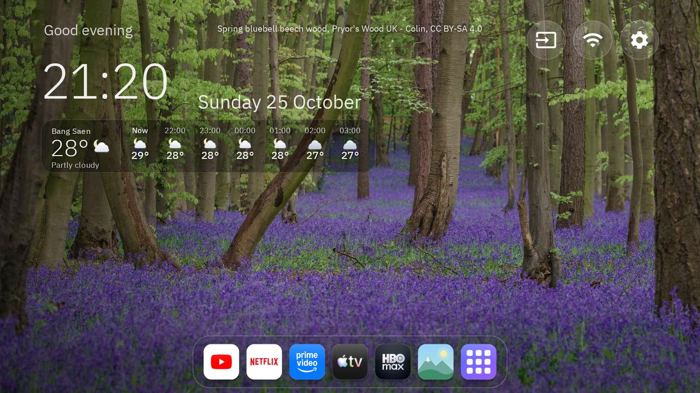
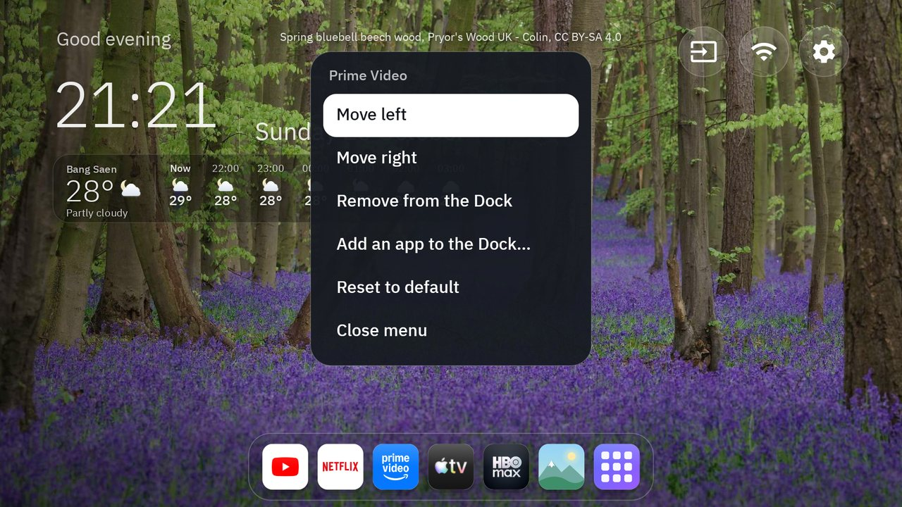
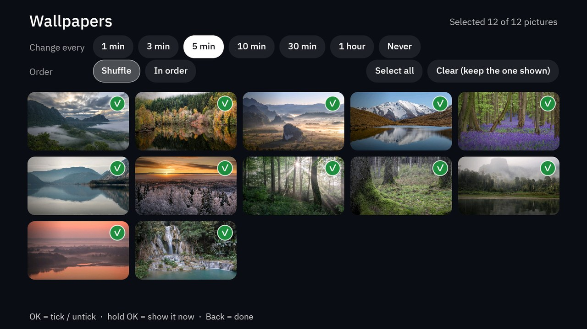
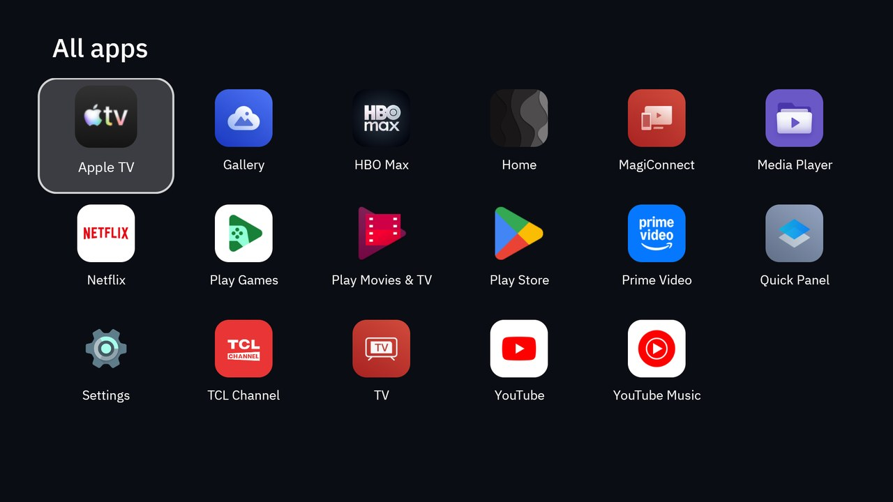
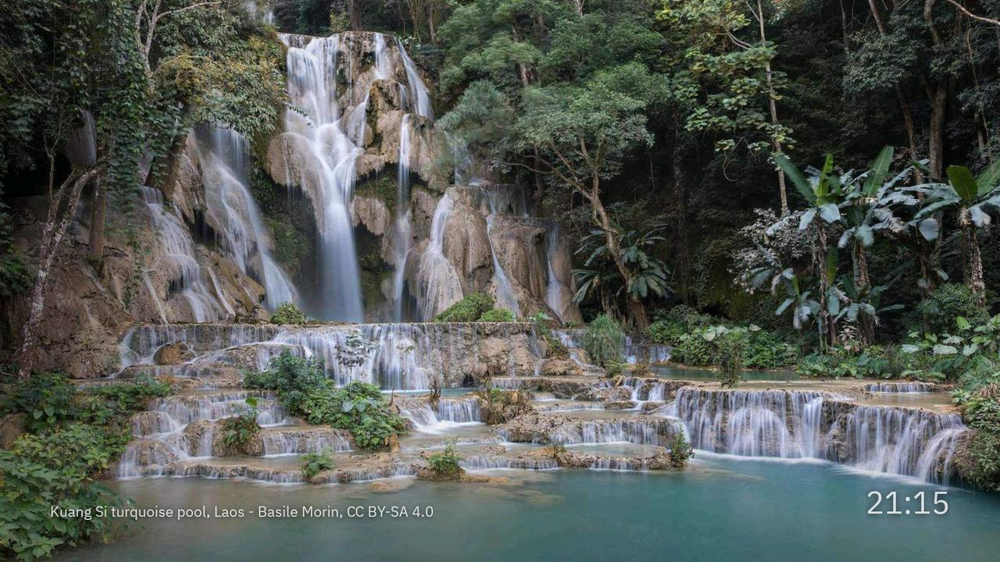

# tvhome-nature

A calm, photo-first Home screen for Android TV and Google TV: a macOS-style Dock, an hourly weather strip, a wallpaper
manager with a timer, a photo-slideshow screensaver, and an included nature theme.

It is a fork of [Clean Your TV](https://github.com/Gathin23/cleanyourtv) by Gathin (MIT). That project debloats a TV and
installs a light launcher; this one adds the features below on top of its launcher. If you want the debloat lists, the
TV database and the other themes, use the original.



## What it adds

| | |
|---|---|
| **Dock** | Icons along the bottom that grow as the selection passes (like the macOS Dock), with the name above. They sit at normal size until you press a key, then rest again after eight seconds. OK opens the app with a small bounce. |
| **Edit the Dock** | Hold OK on an app: move left or right, remove it, add any installed app, or reset. Your order is kept. |
| **Wallpapers** | The icon after your apps. Tick the pictures you want, choose how often Home changes picture (1 min to 1 hour, or never), shuffle or in order. Hold OK on a picture to show it now. Pictures you push but never ticked stay out of the rotation. |
| **Video clips** | Put silent looping `.mp4` clips on the TV and they are mixed into the rotation with your pictures: tick them in Wallpapers like any picture, and choose how often one comes up (off, few, some, often). A clip plays for the time you set, then Home moves on. It stops and shows the last still when the TV is left alone for 30 minutes, and the decoder is released when you open another app. |
| **Screensaver** | Replaces the TV's own: your ticked pictures, full screen, slow cross-fade and drift, the photographer's name and the time. Any key wakes the TV. |
| **Weather strip** | Now plus the next seven hours under the clock, with hand-drawn icons. Data from Open-Meteo. |
| **Fonts** | IBM Plex Sans Thai; Thai and English texts follow the TV's language. |
| **nature-calm theme** | Twelve calm Commons photos with credits. |

 
 

## Tested on

One TV: **TCL Smart TV Pro (G08), Android 14 (Google TV), firmware UTT2.250416.001 AU02**. Nothing here was tried on another
model. The D-pad flows were checked on that TV with injected keys; the real remote's buttons were not all re-tested after
every change.

## Differences from the original launcher (read this first)

- **It asks for the `INTERNET` permission** and fetches the weather. The original launcher deliberately has none. The only
  request is one to `api.open-meteo.com` every 30 minutes while Home is on screen, with your rounded coordinates and time zone,
  no account and no key. Remove `WeatherStrip` from `activity_main.xml` and the permission from the manifest if you do not want it.
- **The APK is about 700 KB**, over the original project's 480 KB limit, mostly because of the Thai fonts. That is why this is
  a separate project rather than a pull request.
- **The grid of tiles is gone**: Home is the Dock plus an all-apps screen.

## Install

You need a JDK 17, the Android SDK (platform 34, build-tools 34.0.0), and adb with debugging switched on for the TV.

```bash
cd launcher
echo "sdk.dir=$HOME/Library/Android/sdk" > local.properties     # your SDK path
./gradlew assembleRelease
adb connect 192.168.1.50:5555                                   # your TV's address
adb install -r app/build/outputs/apk/release/app-release.apk
adb shell cmd package set-home-activity --user 0 com.gathin.tvhome/.MainActivity
```

Then the pictures and the theme:

```bash
tools/push-pictures.sh themes/nature-calm 192.168.1.50:5555
```

Clips go in a `videos/` folder next to `config.json` (for example `themes/mine/videos/v01.mp4`, names of letters, digits, `_` and `-`); the same script pushes them. A caption for a clip goes in `wallpapers/captions.txt` like a picture's.

The original project's guide (<https://github.com/Gathin23/cleanyourtv>) covers disabling the stock launcher and the other
steps for making this the only Home. Do that before you disable anything: a TV with no launcher that answers Home is hard to recover.

### Screensaver

```bash
adb shell settings put secure screensaver_components com.gathin.tvhome/.SlideshowDream
adb shell appops set com.gathin.tvhome AUTO_START allow ; adb shell appops write-settings    # TCL firmware only
```

TCL's firmware refuses to bind a screensaver service from an app that does not hold `AUTO_START` (the log says
`forbid bind service`); other makes may not need the second line. To go back to the TV's own:
`adb shell settings put secure screensaver_components <the value you had>` (read it first with `settings get`).
The screensaver starts after the TV's own idle time.

## Change the city

The weather place is in `launcher/app/src/main/res/values/config.xml`:

```xml
<string name="weather_lat" translatable="false">13.30</string>
<string name="weather_lon" translatable="false">100.91</string>
<string name="weather_place" translatable="false">Bang Saen</string>
<string name="weather_tz" translatable="false">Asia/Bangkok</string>
<string name="weather_hours" translatable="false">7</string>
```

Use your own latitude and longitude (decimal degrees, about one kilometre is plenty), the name to show, an
[IANA time zone](https://en.wikipedia.org/wiki/List_of_tz_database_time_zones) and how many hours (3 to 10). When the TV is set to
Thai the name comes from `values-th/weather.xml`. Rebuild and reinstall.

## Known limits

- The slideshow's seconds per picture (30) is set in code, not in a menu.
- The weather has not been tested with the internet down for long; it shows the last answer it saved, or "loading".
- Dock editing keeps only apps that are installed; an app you uninstall disappears from the Dock.
- Pictures beyond 100 are ignored (the original launcher's limit).
- **No clips are included.** Free stock-video licences usually forbid redistributing the files, so none are committed. Use your own, or clips whose licence lets you pass them on. Best: 1920x1080, H.264, no audio, about 5 Mbps or less, 20 to 45 seconds, and a fixed camera (a moving camera is tiring behind the interface). Measured on the TCL above, one clip adds about 30 to 45 MB to the launcher's memory and about a quarter of one core, using the TV's hardware decoder.
- Only the Thai and English texts of the new screens exist.

## Licence and credits

MIT, see [LICENSE](LICENSE). Fonts, photos and the weather data have their own terms: see [NOTICE.md](NOTICE.md) and
[themes/nature-calm/CREDITS.md](themes/nature-calm/CREDITS.md). The photographers' names are shown on screen with each picture.
